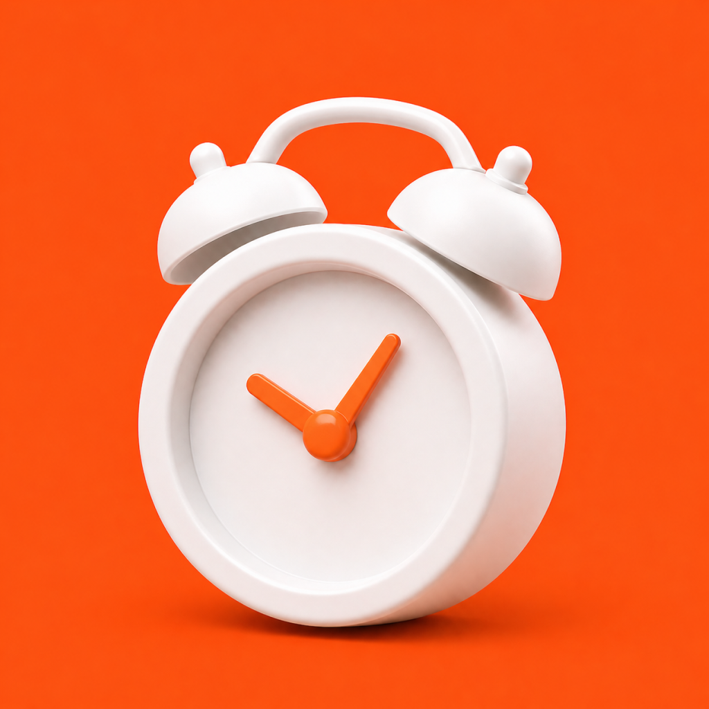

#  Unsnooze

Join 5,000+ users and turn your alarm clock into a challenge by completing physical and mental activities

Download for iOS: https://apps.apple.com/us/app/unsnooze-challenge-alarm-clock/id6758871228 

## Features
* Create & Manage Alarms: Set alarms for any schedule and customize them to fit your morning routine.
* Wake-Up Challenges: Turn off your alarm by completing tasks like push-ups, math problems, memory games, walking, phone shaking, and more.
* Loud Alarm Sounds: Choose from 20+ loud alarm tones designed for heavy sleepers.
* Custom Motivational Messages: Record your own messages to remind yourself why getting up matters.
* Import Custom Songs: Wake up to your favorite music instead of generic alarm sounds.
* Streaks & Statistics: Track your consistency and build a streak of successful mornings. Unlock achievements and view your progress
* Smart Reminders: Get notifications that help you stay consistent with your alarms and routines.

## Built With
React Native, Expo, TypeScript / JavaScript, SQLite, Firebase, Swift

## Pictures

  
  
  
  
  
  

